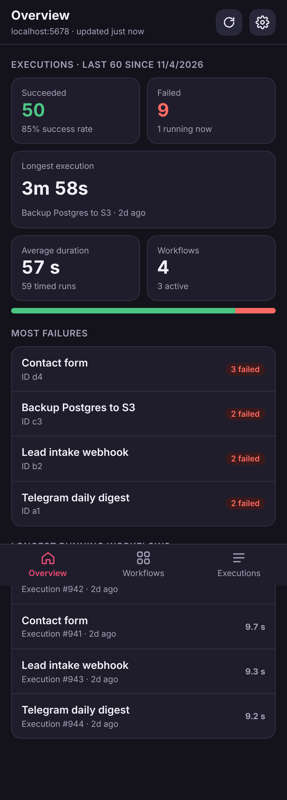
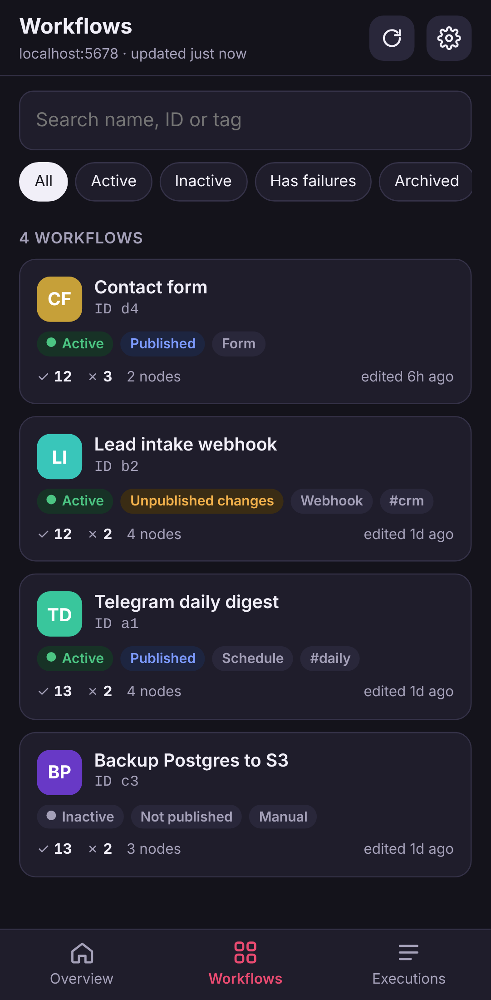
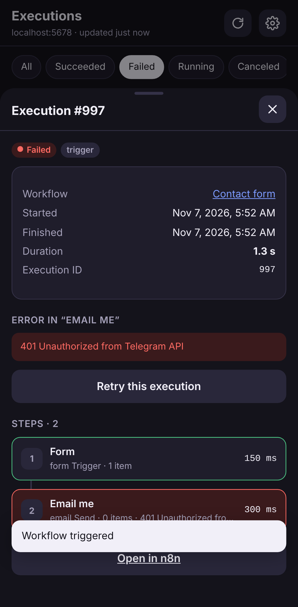

# n8n Mobile

A small installable web app (PWA) for Android that connects to your self-hosted n8n and lets you see and run your workflows from your phone.

<p>
  
  
  
</p>

**Two ways to use it:** install the **Android APK** from [Releases](https://github.com/0XZEROX0/n8n-app/releases/latest) (no server needed, see [docs/android.md](docs/android.md)), or host it as a web app next to n8n (below).

More docs: [Android APK](docs/android.md) · [Deployment](docs/deployment.md) · [Architecture](docs/architecture.md) · [n8n API notes](docs/n8n-api-notes.md) · [Changelog](CHANGELOG.md)

## Features

- **Overview**: succeeded vs failed executions, success rate, longest execution (and which workflow), average duration, active workflow count, the workflows that fail most, and the longest-running ones.
- **Workflows**: one card per workflow with Active/Inactive, Published / Unpublished changes / Not published (n8n 2.x), trigger type, tags, ID, success/fail counts and last edit. Search and filter (active, inactive, has failures, archived).
- **Workflow details**: ID, owner, created/edited dates, nodes, triggers, settings, a *Flow* tab that draws the workflow like the n8n editor (nodes as blocks with their icons, connections as lines, AI sub-nodes, sticky notes; drag, pinch to zoom, full screen, tap a node for its details; read-only), a *Runs* tab with that workflow's stats, and a *History* tab (current and published version; see limits below). Activate / deactivate from the phone.
- **Run**: workflows with a Webhook trigger get a Run button (method, path, JSON body, optional auth headers) and show the response. Form triggers open the form.
- **Home screen widget** (Android app): one resizable widget, one workflow per cell (1x1 = 1, 2x1 = 2, 2x2 = 4, …), each with its last run status and a play button. See [docs/android.md](docs/android.md#home-screen-widget).
- **Executions**: filter by status, open any run to see each step, its time, items, the error message, and the output. Retry failed runs.

## How you sign in

Just like n8n in a browser:

1. Enter your n8n address (the public link you open n8n with) and tap **Continue**. The app checks it really is n8n.
2. If your server or reverse proxy asks for its own password before n8n (HTTP basic auth), the app asks for that next.
3. Sign in with your n8n **email and password** (or LDAP username, if your n8n uses LDAP).
4. If your account has **two-step verification**, enter the 6-digit code from your authenticator app (or a recovery code).

The app keeps n8n's normal sign-in session (about a week, set by n8n) and never stores your n8n password. Single sign-on pages (SAML/OIDC) and sign-in pages in front of n8n such as Cloudflare Access or Authelia aren't supported yet.

## In-app updates (Android)

Every change merged to `main` is built by GitHub Actions and published as the rolling [`android` release](https://github.com/0XZEROX0/n8n-app/releases/tag/android). The app checks it when it opens and shows **An update is out** with what changed; tap **Update now** and it downloads the new APK and opens Android's installer. You can also check any time under **Settings → App → Check for updates**. The first time, Android asks you to allow installs from n8n Mobile.

## Android APK (easiest)

Download [`n8n-mobile.apk`](https://github.com/0XZEROX0/n8n-app/releases/download/android/n8n-mobile.apk), open it on your phone, and allow the install. The APK connects to n8n directly, so no server or CORS setup is needed. Details and signing: [docs/android.md](docs/android.md).

## Running it as a web app (next to your n8n)

Browsers block a web page from calling another site's API unless that site allows it (CORS), and n8n's API doesn't allow it by default. So the app comes with a tiny server (`server.js`, no dependencies) that serves the app **and** forwards API calls to n8n. No CORS setup needed.

### Option A: Docker (same host as n8n)

```bash
docker build -t n8n-mobile .
docker run -d --name n8n-mobile --restart unless-stopped -p 8080:8080 \
  -e N8N_URL=https://n8n.example.com n8n-mobile
```

### Option B: plain Node 18+

```bash
N8N_URL=https://n8n.example.com PORT=8080 node server.js
```

Then put it behind HTTPS (required for "Install app" on Android), e.g. with the reverse proxy you already use for n8n:

```
# Caddy
mobile.example.com {
    reverse_proxy localhost:8080
}
```

```
# nginx
server {
    server_name mobile.example.com;
    location / { proxy_pass http://127.0.0.1:8080; proxy_set_header Host $host; }
    # ... your usual ssl settings
}
```

### Install on Android

Open `https://mobile.example.com` in Chrome → menu ⋮ → **Install app** (or "Add to Home screen"). It opens full-screen like a normal app.

### Option C: static hosting, no server (not for sign-in)

Signing in uses n8n's session cookie, which browsers won't send to another site, so the web version needs `server.js` (or the Android app). The notes below only matter if you host n8n and the app on the same domain yourself.

You can host the `public/` folder anywhere static (GitHub Pages, Netlify…). The browser then calls n8n directly, so your n8n reverse proxy must send CORS headers for `/api/` and `/webhook/`, for example in nginx:

```
location ~ ^/(api|webhook)/ {
    add_header Access-Control-Allow-Origin "https://your-app-host" always;
    add_header Access-Control-Allow-Headers "X-N8N-API-KEY, Content-Type, Authorization" always;
    add_header Access-Control-Allow-Methods "GET, POST, PUT, PATCH, DELETE, OPTIONS" always;
    if ($request_method = OPTIONS) { return 204; }
    proxy_pass http://127.0.0.1:5678;
}
```

## Security notes

- `server.js` only forwards to the single `N8N_URL` you set. It does not store anything. (`ALLOW_ANY_TARGET=1` lets the app choose the URL, which makes it an open proxy; only use that on a private network.)
- Your phone holds a normal n8n session, like a signed-in browser. Signing out in the app (Settings) ends it. Your n8n password is never stored.

## Good to know

- **Running a workflow**: **Run now** starts workflows with a Manual, Schedule or similar trigger, like pressing *Execute workflow* in n8n (it runs the latest saved version). Webhook workflows are run by calling their webhook; Form triggers open the form.
- **Edit history**: the History tab lists every saved version with who saved it. n8n keeps history for a limited time on the free plan, so very old versions may be gone.
- **Created by** is the author of the first saved version, when n8n still keeps it. **Owner** is the project that owns the workflow.
- **Stats** are computed from the most recent N executions n8n still keeps (default 500, change in Settings). n8n prunes old executions on its own schedule.
- The app uses n8n's own signed-in API (the one the n8n editor uses). It's tested with n8n 2.46; if a future n8n changes it, an app update will follow.

## Files

```
server.js            app server + n8n API forwarder (zero dependencies)
Dockerfile
public/index.html    app shell
public/app.js        all app logic
public/styles.css    mobile-first styles (light/dark)
public/sw.js         offline app shell cache (never caches n8n data)
public/manifest.webmanifest, public/icons/
capacitor.config.json  Android wrapper settings (Capacitor, native HTTP)
android/             Android Studio project for the APK
assets/              icon and splash sources for the APK
.github/workflows/android.yml   builds the APK, publishes the rolling "android" release
scripts/release-notes.mjs       writes that release's "what changed" notes
```
